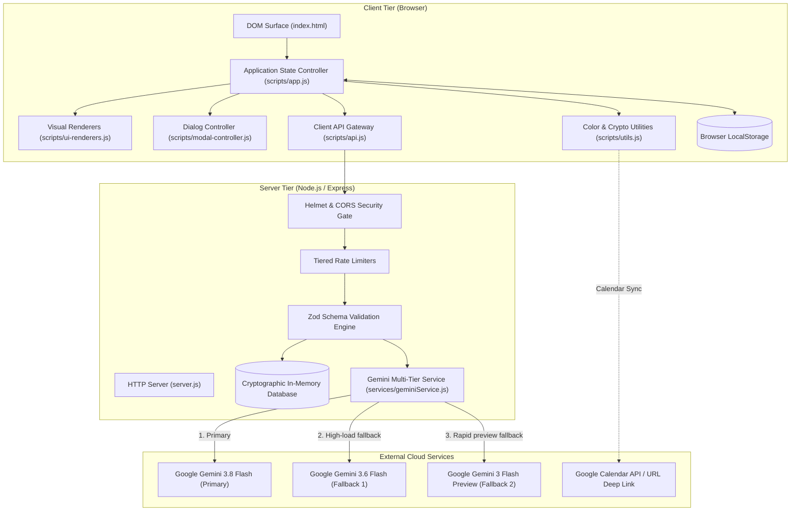
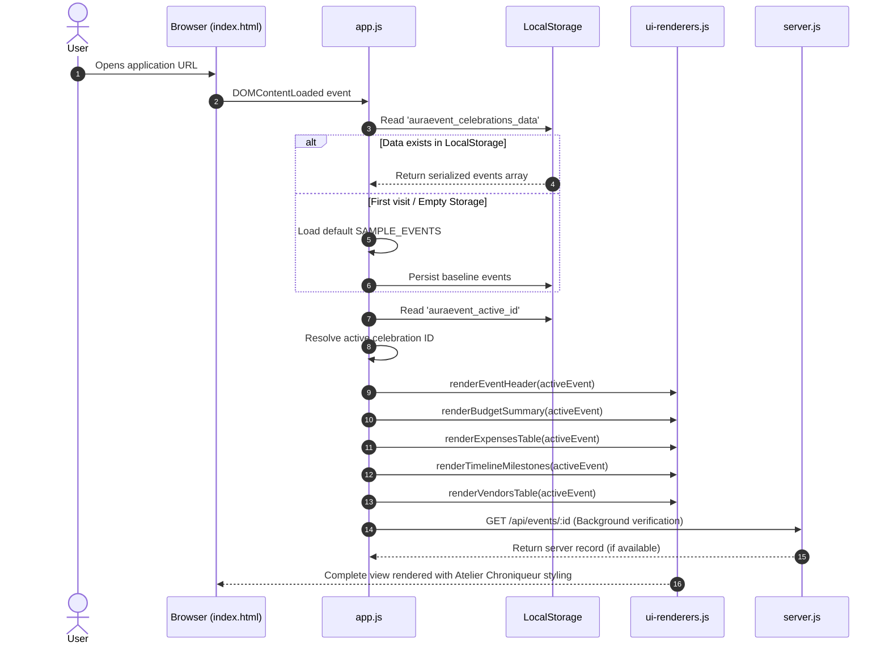
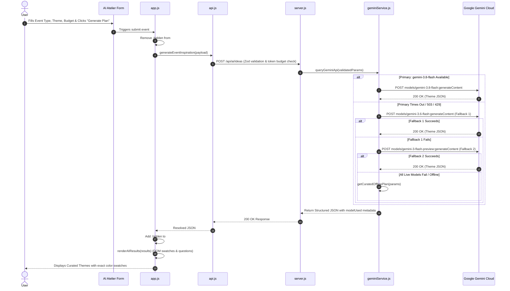

# AuraEvent — Architecture & Component Data Flow Specification

## 1. System Overview & Technology Stack

AuraEvent is an enterprise-grade, browser-based event planning and celebration management application designed around the **Atelier Chroniqueur** design language. It combines client-side reactivity and offline durability with a secure Node.js backend proxy communicating with Google Gemini generative models.



---

## 2. Component Inventory & Responsibility Matrix

| Component File | Architectural Role | Key Functions / Classes | Inputs & Outputs | Security & Failure Controls |
| :--- | :--- | :--- | :--- | :--- |
| `index.html` | Presentation Shell & CSP Anchor | Semantic HTML5 structure, Accessible Dialogs, Skip Link | User pointer & keyboard events | Strict CSP meta tag, zero inline script executions |
| `styles/main.css` | Design System Tokens & Component Styling | CSS custom properties, Atelier Chroniqueur tokens, animations | CSS class selectors | High contrast tokens, WCAG 2.1 AA focus rings, global `.hidden` |
| `scripts/app.js` | Main Application Controller & State Bus | `initApp()`, `refreshActiveView()`, `persistAndSync()` | DOM event triggers, `APP_STATE` mutations | Safe JSON serialization, fallback to sample data |
| `scripts/modal-controller.js` | Modal Dialog Life-Cycle Manager | `initModalController()`, `openModal()`, `closeActiveModal()` | Modal button clicks, keyboard Escape triggers | Focus trap, inert management, aria attributes |
| `scripts/ui-renderers.js` | Dynamic DOM Renderers | `renderEventHeader()`, `renderBudgetSummary()`, `renderAIResults()` | Celebration event models, Gemini suggestion payloads | DOM API element construction, XSS protection via `textContent` |
| `scripts/api.js` | Client Network Facade | `generateEventInspiration()`, `syncEventData()`, `fetchEventData()` | Event context, tokenized ownership headers | Exponential retry, offline fallback interception |
| `scripts/utils.js` | Core Business & Cryptographic Utilities | `resolveCssColor()`, `formatCurrency()`, `buildGoogleCalendarUrl()` | Raw hexes, dates, numbers, calendar configs | Multi-regex parser, ISO date sanitation |
| `scripts/events-data.js` | Default Baseline State | `SAMPLE_EVENTS`, `getEmptyEvent()` | Default event templates | Immutable baseline objects |
| `server.js` | Secure Backend Gateway & API Server | Express router, Helmet middleware, Zod schemas | HTTP requests (`/api/ai/ideas`, `/api/events/:id`) | IP rate limiting, token budget enforcement, owner tokens |
| `services/geminiService.js` | AI Multi-Tier Proxy & Orchestrator | `queryGeminiApi()`, `checkAndUpdateTokenBudget()` | Event parameters, API key | Multi-tier fallback chain, secret masking |

---

## 3. End-to-End Workflow Traces

### Workflow 1: Application Startup and Initialization


- **UI Component:** Brand header, event selector dropdown `#event-select-input`, masthead countdown.
- **JavaScript Function:** `initApp()` in `scripts/app.js`.
- **API Endpoint:** `GET /api/events/:id` (optional background sync).
- **Backend Service:** Express in-memory database lookup in `server.js`.
- **Data Structure:** `APP_STATE = { events: Array<Event>, activeId: string }`.
- **Display Result:** Full dashboard view populated with active celebration details.
- **Fallback:** If LocalStorage is unavailable (private mode restrictions), in-memory baseline loads quietly without throwing unhandled exceptions.

---

### Workflow 2: Creating a New Celebration
- **UI Component:** Header button `#btn-create-event` ("+ New Celebration") and modal `#modal-new-event`.
- **JavaScript Function:** `initModalController()` in `scripts/modal-controller.js` -> `handleEventCreated()` in `scripts/app.js`.
- **API Endpoint:** `PUT /api/events/:id` via `syncEventData()`.
- **Backend Service:** Parameterized record insertion in `server.js`.
- **Data Structure:**
  ```javascript
  {
    id: UUIDv4,
    name: string,
    type: "Wedding" | "Birthday" | "Community Event",
    date: ISO8601,
    budget: number,
    guestCount: number,
    expenses: [],
    milestones: [],
    vendors: []
  }
  ```
- **Display Result:** Modal closes, new celebration is prepended to selector, view switches to new event, toast alerts "Celebration created successfully!".
- **Error Handling:** Form fields enforce HTML5 and JS validation (budget > 0, guest count >= 1); errors display inline without modal closure.

---

### Workflow 3: Switching Between Multiple Celebrations
- **UI Component:** `#event-select-input` in masthead.
- **JavaScript Function:** Event listener on `change` in `scripts/app.js`.
- **API Endpoint:** None (Client-side instantaneous switch with background state verification).
- **Data Structure:** Updates `APP_STATE.activeId` and `localStorage.setItem('auraevent_active_id', id)`.
- **Display Result:** Budget metrics, expense ledger, milestone ribbon, and vendor directory instantly re-render corresponding to selected event.
- **Isolation Guarantee:** Events have completely decoupled IDs; arrays are mutated strictly by referencing `getActiveEvent()`.

---

### Workflow 4: Editing and Persisting Event Information
- **UI Component:** Event details card, quick adjustment inputs.
- **JavaScript Function:** `persistAndSync()` in `scripts/app.js`.
- **API Endpoint:** `PUT /api/events/:id` (Header: `x-event-token`).
- **Backend Service:** Mutation validator in `server.js`.
- **Storage:** Synced to `localStorage` immediately; queued to server via debounced network dispatch.
- **Display Result:** Visual metrics refresh in real time; sync status indicator confirms persistence.
- **Error Handling:** If server returns 403 (mismatched owner token), client maintains local copy and logs security rejection.

---

### Workflow 5: Adding and Removing Expenses
```mermaid
sequenceDiagram
    autonumber
    actor User as User
    participant UI as Expense Ledger UI
    participant Modal as modal-controller.js
    participant App as app.js
    participant Render as ui-renderers.js
    participant Storage as LocalStorage

    User->>UI: Clicks "Add Expense Item"
    UI->>Modal: openModal('modal-expense')
    User->>Modal: Fills Category, Name, Cost, Status & Submits
    Modal->>App: Appends new expense record to activeEvent.expenses
    App->>Storage: saveCelebrations() to LocalStorage
    App->>Render: renderBudgetSummary(activeEvent)
    App->>Render: renderExpensesTable(activeEvent)
    Render-->>UI: Table displays new row; Budget progress bar updates
```

- **UI Component:** `#btn-add-expense`, `#modal-expense`, `#form-add-expense`, `.btn-delete-expense`.
- **JavaScript Function:** Form submit listener in `scripts/modal-controller.js`; delete listener in `scripts/app.js`.
- **Math & Logic:** Generates unique expense UUID, adds cost to expense array, or filters out target ID.
- **Display Result:** Expense item appears with status badge; Total Spent increments; Remaining Balance recalculates.

---

### Workflow 6: Calculating Budget Utilisation and Remaining Balance
- **UI Component:** Budget Summary card, `#budget-progress-bar`, `#budget-remaining-display`.
- **JavaScript Function:** `renderBudgetSummary(event)` in `scripts/ui-renderers.js`.
- **Mathematical Formula:**
  $$\text{Total Spent} = \sum_{i=1}^n \text{expense}_i.\text{cost}$$
  $$\text{Remaining Balance} = \text{Total Budget} - \text{Total Spent}$$
  $$\text{Utilisation Percentage} = \min\left(100, \left\lfloor \frac{\text{Total Spent}}{\text{Total Budget}} \times 100 \right\rfloor\right)$$
- **Display Result:**
  - If $\text{Remaining} \ge 0$: Progress bar styled in accent gold (`#D97706`), variance label reads "Remaining: $X".
  - If $\text{Remaining} < 0$: Progress bar switches to crimson danger (`#DC2626`), variance label reads "Over budget by $X".

---

### Workflow 7: Creating and Completing Timeline Milestones
- **UI Component:** `#btn-add-milestone`, `#modal-milestone`, `.btn-toggle-milestone` on ribbon.
- **JavaScript Function:** `scripts/modal-controller.js` and `scripts/ui-renderers.js`.
- **Data Structure:** `{ id: UUID, title: string, date: ISO, phase: string, notes: string, completed: boolean }`.
- **Sorting Logic:** Array sorted chronologically by `new Date(item.date).getTime()`.
- **Display Result:** Milestones displayed on vertical timeline ribbon; toggling checks off item, strikes through typography, and increments countdown progress.

---

### Workflow 8: Adding Vendors and Updating Vendor Statuses
- **UI Component:** `#btn-add-vendor`, `#modal-vendor`, `#vendor-table-body`, `.btn-vendor-status`.
- **JavaScript Function:** `scripts/modal-controller.js` and `scripts/app.js`.
- **State Machine:**
  $$\text{Inquiry} \longrightarrow \text{Quoted} \longrightarrow \text{Contracted} \longrightarrow \text{Paid}$$
- **Display Result:** Status badge dynamically transitions between warning yellow, info blue, accent gold, and success emerald.

---

### Workflow 9 & 10: Requesting AI Inspiration & Multi-Tier Fallback Processing


- **UI Component:** `#form-ai-prompt`, `#ai-loading-indicator`, `#ai-results-wrapper`.
- **JavaScript Functions:** `generateEventInspiration()` in `scripts/api.js`, `renderAIResults()` in `scripts/ui-renderers.js`.
- **Backend Function:** `queryGeminiApi()` in `services/geminiService.js`.
- **Security Check:** `checkAndUpdateTokenBudget()` clamps consumption; prompt delimiters stripped by `sanitizePromptInput()`.
- **Issue A Fix:** `#ai-loading-indicator` is kept hidden by `.hidden { display: none !important; }` until form submission.
- **Issue B Fix:** Swatches are constructed as DOM nodes with `swatch.style.backgroundColor = hex` and `--swatch-color: ${hex}`, resolving hexes, compound names, and embedded color strings.

---

### Workflow 11: Exporting Events to Google Calendar
- **UI Component:** Header action `#btn-export-calendar`, timeline milestone action links.
- **JavaScript Function:** `buildGoogleCalendarUrl()` and `generateICalendarPayload()` in `scripts/utils.js`.
- **Data Flow:**
  - Milestone ISO date converted to UTC formatted string `YYYYMMDDTHHMMSSZ`.
  - Generates direct URL: `https://calendar.google.com/calendar/render?action=TEMPLATE&text=...`.
  - Simultaneously exports complete celebration `.ics` RFC 5545 stream with `VEVENT` blocks.
- **Display Result:** New browser window opens Google Calendar entry; browser downloads `.ics` file.

---

### Workflow 12: Exporting and Restoring JSON Backups
- **UI Component:** `#btn-sync-modal`, `#modal-sync`, `#btn-export-backup`, `#input-restore-json`.
- **JavaScript Function:** `triggerFileDownload()` in `scripts/utils.js`, file reader in `scripts/modal-controller.js`.
- **Validation Pipeline:**
  1. `JSON.parse(fileContent)`
  2. Verify `Array.isArray(parsed)`
  3. Validate schema: Each event contains valid `id`, `name`, `type`, `date`, `budget`.
  4. Repopulate `APP_STATE.events` and commit to `localStorage`.
- **Display Result:** Celebrations restored with full fidelity; view refreshes to show restored event data.

