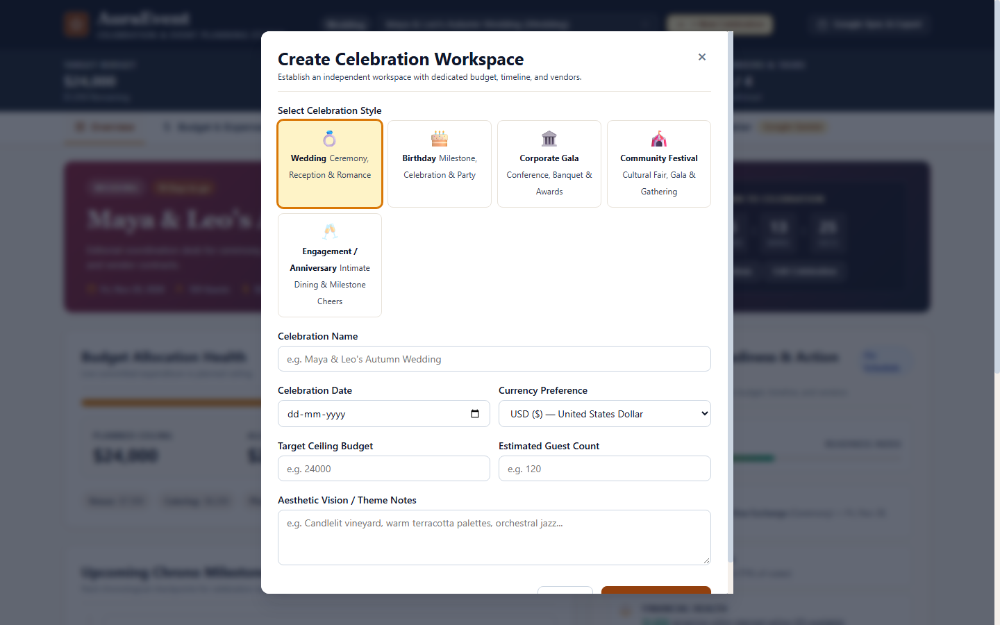
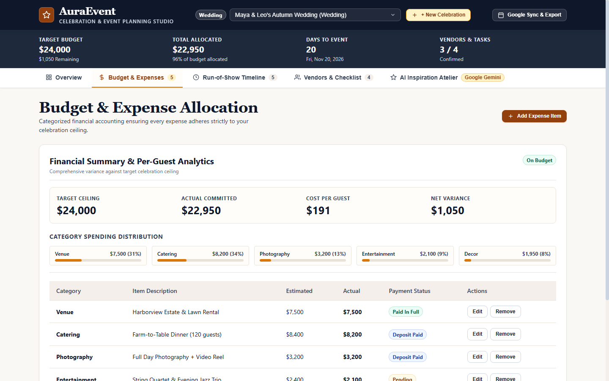
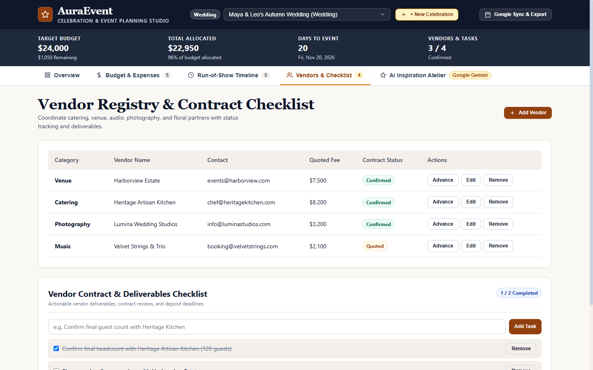

# AuraEvent — Celebration & Event Planning Studio

**Plan meaningful celebrations. Manage every detail. Bring your vision to life.**

AuraEvent is an enterprise-grade celebration and event planning platform designed for weddings, milestone birthdays, corporate galas, and community festivals. Built on the refined **Atelier Chroniqueur** design language, it bridges creative inspiration with strict operational rigor — combining dynamic budget allocation, chronological run-of-show milestone ribbons, vendor registries, calendar synchronization, and Google Gemini generative AI in a single, zero-build web platform.

---

## Visual Showcase

### Overview & Readiness Dashboard

The central command surface provides an at-a-glance operational overview: live countdown clock, target budget ceiling, committed spend, remaining balance, vendor contract statuses, upcoming milestones, and the composite Event Readiness Index.


### Multi-Event Workspace Creator

Easily create and switch between isolated celebration workspaces, each retaining its own budget, guest count, currency preference, vendor roster, and aesthetic vision.



### Budget & Expense Ledger

Track planned vs. actual expenses across categorized line items (Venue, Catering, Decor, Photography, Entertainment, etc.) with real-time variance detection, per-guest financial math, and currency support for USD and INR.



### Run-of-Show Chrono-Ribbon & Google Calendar Sync

Organize activities chronologically across event phases (Planning, Preparation, Execution, Ceremony, Reception, Breakdown). Filter by phase, mark completion, and deep-link milestones directly into Google Calendar or download an RFC 5545 `.ics` calendar feed.


### Vendor Registry & Deliverables Checklist

Manage contracts and contact information across booking stages (Researching, Quoted, Contract Sent, Confirmed, Completed) with interactive sub-task checklists that track deliverables up to event day.



### Google Gemini AI Inspiration Atelier

Harness Google Gemini generative models (`gemini-3.8-flash` with multi-model fallback cascade) to generate tailored color palettes, decor concepts, budget allocations, run-of-show milestones, and strategic vendor questions.


---

## Core Capabilities

1. **Multi-Event Workspace Isolation:** Create and switch seamlessly between celebrations with non-destructive local persistence (`localStorage`) and cryptographic remote synchronization (`/api/events/:id`).
2. **Dynamic Financial Ledger:** Instant calculations of allocated amounts, actual spent, remaining headroom, and cost-per-guest with zero floating-point rounding errors.
3. **Chronological Run-of-Show:** Milestone ribbon supporting phase filtering, live completion toggles, countdown calculations, and direct Google Calendar synchronization.
4. **Vendor Directory & Tasks:** Comprehensive partner tracking with contract statuses, quotes, contact details, and actionable task checklists.
5. **Gemini Multi-Tier AI Cascade:** Generates bespoke celebration proposals using `gemini-3.8-flash`, falling back to `gemini-3.6-flash`, `gemini-3-flash-preview`, and curated domain-expert offline plans if offline.
6. **Plan Preview & Selective Merging:** Inspect AI recommendations, select individual line items, and merge them safely with duplicate detection that preserves existing data.
7. **Readiness & Action Center:** Operational score synthesizing milestones, vendor confirmations, and budget health into a real-time progress gauge.
8. **Data Portability:** Download calendar events as RFC 5545 `.ics` feeds, export complete celebrations to formatted JSON backups, and restore with schema validation.

---

## Technology Stack

- **Client Tier:** Semantic HTML5, CSS3 with centralized design tokens, vanilla ES2022 JavaScript modules. No bundler required for instantaneous loading and zero client supply-chain vulnerabilities.
- **Server Tier:** Node.js (>=18), Express 5, Helmet HTTP security headers, express-rate-limit protection.
- **Validation & Security:** Zod schema enforcement on all API routes, DOMPurify HTML sanitization, cryptographic owner tokens, parameterized lookup security.
- **AI Integration:** Google Gemini REST API proxy with token quota budgeting and input sanitization.
- **Tooling:** ESLint (flat config v10), Prettier code formatting, and native Node test runners.

---

## Project Structure

```text
challenge_5/
├── docs/
│   ├── ARCHITECTURE.md          # Complete architecture & subsystem specification
│   ├── DESIGN.md                # Atelier Chroniqueur design tokens & typography
│   └── screenshots/             # High-resolution UI captures (desktop, tablet, mobile)
├── scripts/
│   ├── app.js                   # Main application controller & state machine
│   ├── api.js                   # Client REST API gateway with retry logic
│   ├── config.js                # Shared configuration constants & limits
│   ├── events-data.js           # Re-export hub for celebration data & persistence
│   ├── events-seed.js           # Canonical seed templates & schema normalization
│   ├── events-storage.js        # Browser localStorage persistence layer
│   ├── modal-controller.js      # Modal re-export hub
│   ├── types.js                 # JSDoc @typedef definitions for all data models
│   ├── utils.js                 # Currency, dates, crypto, calendar & AI normalization
│   ├── modals/                  # Modular dialog & form controllers
│   │   ├── core.js              # Dialog opening, closing, and focus traps
│   │   ├── export.js            # iCalendar export and JSON backup/restore
│   │   ├── forms-celebrations.js# Celebration creation & detail edit forms
│   │   ├── forms-expenses.js    # Expense creation & edit forms
│   │   ├── forms-milestones.js  # Milestone creation & edit forms
│   │   ├── forms-vendors.js     # Vendor registration & checklist forms
│   │   ├── helpers.js           # Shared form action lifecycle runner
│   │   └── index.js             # Modals orchestrator & barrel export
│   └── renderers/               # Single-responsibility DOM renderers
│       ├── ai-milestones.js     # AI suggested run-of-show milestones renderer
│       ├── ai-results.js        # AI workshop allocations & coordinator
│       ├── ai-themes.js         # AI themes, swatches & vendor questions
│       ├── budget.js            # Budget KPIs, category gauges & expense table
│       ├── index.js             # Renderers barrel export
│       ├── overview.js          # Masthead metrics, overview cards & readiness center
│       ├── plans.js             # Saved plans library & application preview modal
│       ├── timeline.js          # Chrono-ribbon & Google Calendar deep links
│       └── vendors.js           # Vendor table & deliverables checklist
├── services/
│   ├── curatedOfflinePlans.js   # Offline fallback plan templates & engine
│   └── geminiService.js         # Multi-model Gemini cascade & rate limiter
├── styles/
│   └── main.css                 # CSS custom properties, responsive layout & components
├── tests/
│   ├── browser_verify.js        # In-browser DOM verification module
│   ├── code_quality_check.js    # Static analysis (secrets, console, catches, imports)
│   ├── e2e.test.js              # Comprehensive end-to-end acceptance suite (39 checks)
│   ├── regression.test.js       # Refactoring regression test suite (31 checks)
│   ├── run_tests.js             # Unit, security, and integration test runner (49 checks)
│   └── test_suite.html          # Browser-based visual test runner
├── .editorconfig                # Multi-editor whitespace & indentation standard
├── .env.example                 # Environment variable templates
├── .gitignore                   # Strict isolation of secrets & build artifacts
├── .prettierignore              # Formatting ignores
├── .prettierrc                  # Prettier formatting rules
├── eslint.config.js             # ESLint flat config with recommended rules
├── index.html                   # Semantic application shell & accessible markup
├── LICENSE                      # MIT Open Source License
├── package.json                 # Project manifest & npm scripts
├── render.yaml                  # Infrastructure-as-code for Render deployment
└── server.js                    # Secure Express backend proxy & static asset server
```

---

## Getting Started

### Prerequisites

- **Node.js** >= 18.0.0
- **npm** >= 9.0.0

### 1. Installation

Clone the repository and install dependencies:

```bash
git clone https://github.com/your-username/auraevent.git
cd auraevent
npm install
```

### 2. Configure Environment Variables

Copy the example environment configuration:

```bash
cp .env.example .env
```

Open `.env` and set your credentials:

```env
PORT=3000
NODE_ENV=development
# Optional: Provide Google Gemini API Key for live AI generation.
# If omitted or quota exhausted, AuraEvent gracefully falls back to its offline engine.
GEMINI_API_KEY=your_gemini_api_key_here
```

### 3. Run Application

Start the local server:

```bash
npm start
```

For automatic reload during development:

```bash
npm run dev
```

Open your browser and navigate to `http://localhost:3000`.

---

## Verification & Quality Tooling

AuraEvent adheres to the highest code quality and testing standards:

| Command                | Purpose                                                                              | Expected Result                          |
| :--------------------- | :----------------------------------------------------------------------------------- | :--------------------------------------- |
| `npm test`             | Executes static quality checks, unit tests, regression tests, and acceptance suites. | **124/124 tests pass (0 failures)**      |
| `npm run lint`         | Runs ESLint across all JavaScript files with flat config.                            | **0 errors, 0 warnings**                 |
| `npm run lint:fix`     | Automatically corrects fixable linting issues.                                       | Clean pass                               |
| `npm run format`       | Formats all code, docs, and styles using Prettier.                                   | Applied cleanly                          |
| `npm run format:check` | Validates that repository code adheres to Prettier formatting.                       | **All matched files use Prettier style** |

---

## Deployment on Render

The repository includes a ready-to-deploy `render.yaml` specification.

### Deployment Steps:

1. Connect your GitHub repository to [Render](https://render.com).
2. Create a new **Web Service** or use **Blueprints** targeting `render.yaml`.
3. Set the build and start commands:
   - **Build Command:** `npm install`
   - **Start Command:** `node server.js`
4. Configure environment variables in the Render dashboard:
   - `PORT`: `10000` (Render binds automatically)
   - `NODE_ENV`: `production`
   - `GEMINI_API_KEY`: _(Your Google Gemini API Key)_
5. The service provides health check probes at both `/api/health` and `/health`.

---

## License

This project is licensed under the MIT License — see the [LICENSE](LICENSE) file for details.
