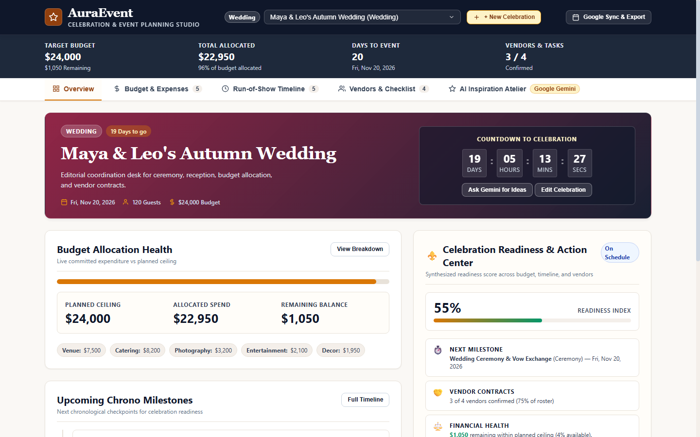
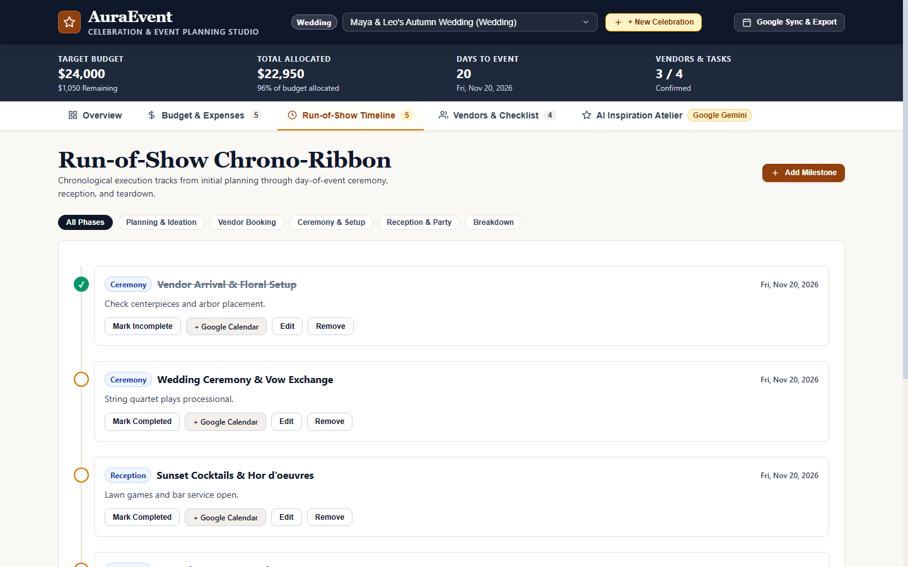
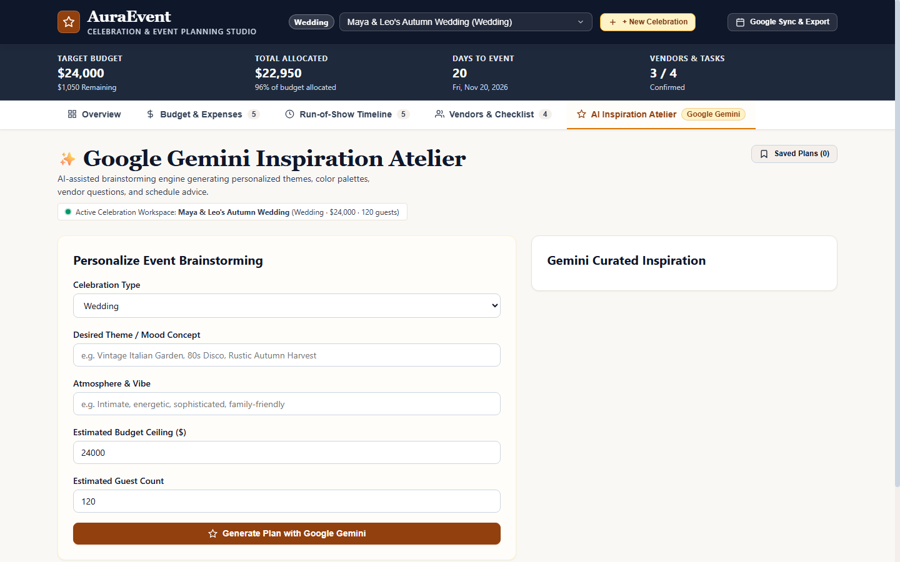
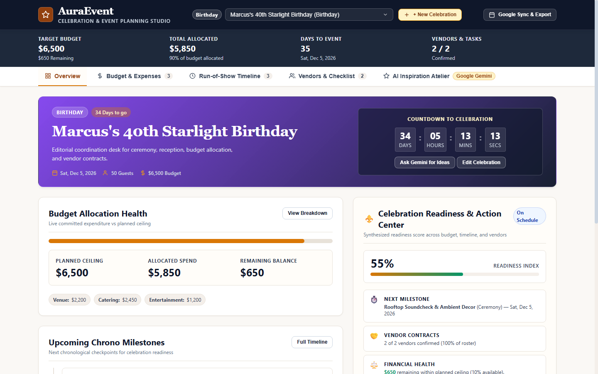
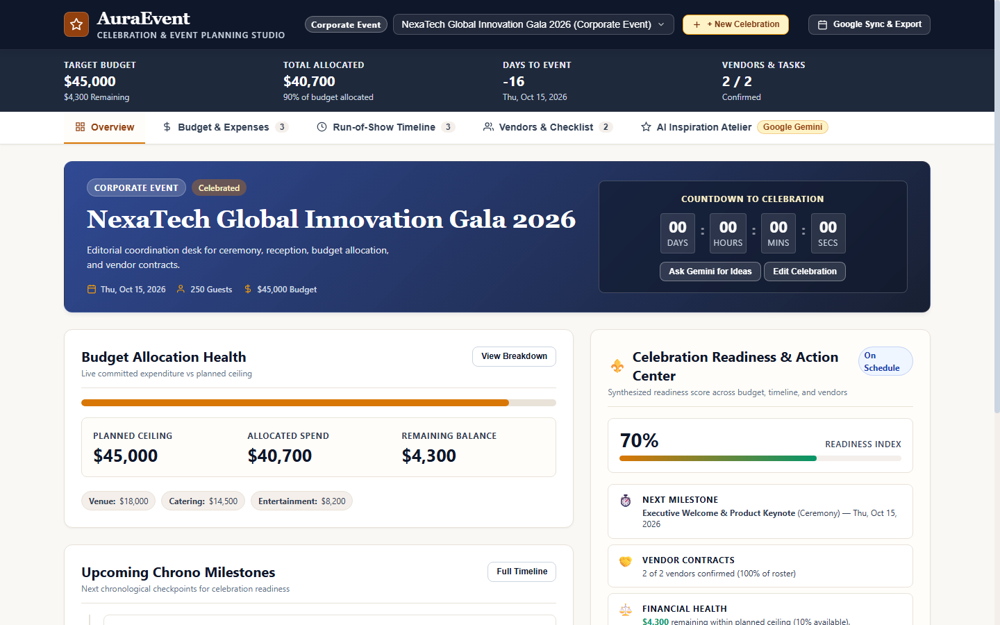
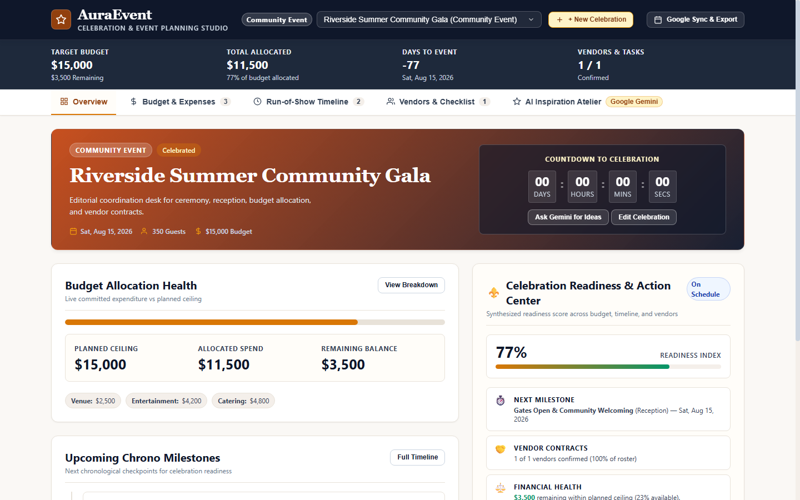
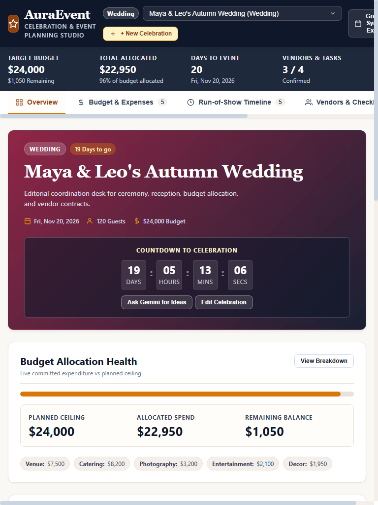
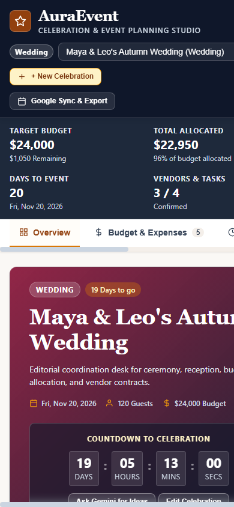
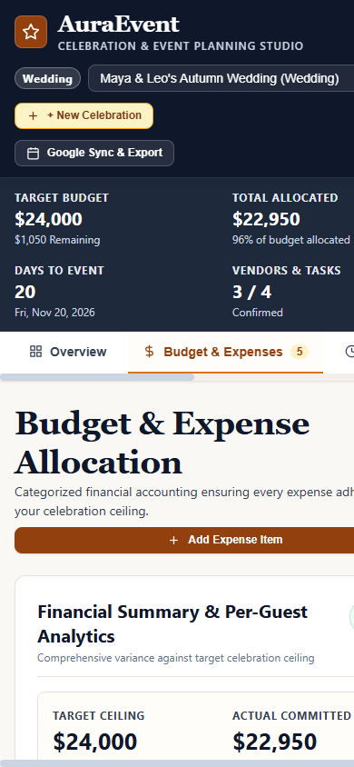

# AuraEvent — Celebration & Event Planning Studio

**Plan meaningful celebrations. Manage every detail. Bring your vision to life.**

AuraEvent is an AI-powered celebration and event planning platform designed to simplify the process of organizing weddings, birthdays, corporate events, community gatherings, and other special occasions.

It combines intelligent event inspiration with practical planning tools, allowing users to manage budgets, coordinate vendors, organize event timelines, and develop personalized celebration concepts in one workspace.

Powered by Google Gemini, AuraEvent transforms event planning from a collection of disconnected tasks into a structured and personalized experience.

---

## Application Preview

### Overview Dashboard

The central workspace provides an at-a-glance view of the active celebration, including budget allocation, countdown, vendor progress, upcoming milestones, and overall event readiness.



### Create Celebration Workspace

Create independent workspaces for different celebrations, each with its own event details, budget, guest count, currency preference, and aesthetic vision.


---

## Features

### 1. Celebration Workspace Management
- Create and manage multiple celebrations independently.
- Support for weddings, birthdays, corporate galas, community festivals, and engagements or anniversaries.
- Maintain separate budgets, vendors, milestones, and planning information for each event.
- Apply event-specific visual themes and colour identities.
- Track upcoming celebrations through a live countdown.

### 2. Budget and Expense Management
- Define a target budget for each celebration.
- Organize expenses by categories.
- Track estimated and actual expenditure.
- Monitor allocated amounts and remaining balances.
- Visualize category-wise spending distribution.
- Identify budget overruns and financial variances.
- Support multiple currency preferences, including INR.


### 3. Event Timeline Management
- Organize event activities chronologically.
- Create, edit, and remove milestones.
- Categorize milestones into planning phases.
- Track completion status.
- Filter activities by event phase.
- Generate Google Calendar links and export calendar events.



### 4. Vendor and Checklist Management
- Maintain a centralized vendor registry.
- Organize vendors by service category.
- Store vendor names, contact details, and quoted fees.
- Track contract and booking statuses.
- Manage vendor deliverables through interactive checklists.
- Monitor vendor coordination progress.


### 5. Gemini AI Inspiration Atelier

The AI Inspiration Atelier uses Google Gemini to assist with creative event planning.

Users can provide:
- Celebration type.
- Desired theme or mood concept.
- Atmosphere and overall vibe.
- Estimated budget.
- Guest count.

The AI-assisted planning experience generates personalized event inspiration, including creative themes, colour palettes, vendor recommendations, and scheduling suggestions.

Additional planning capabilities include:
- Generate and regenerate event plans.
- Review and edit generated recommendations.
- Save generated plans.
- Apply selected recommendations or an entire plan to an event workspace.
- Preview proposed changes before applying them.
- Detect potential duplicates when applying recommendations.



### 6. Event Readiness and Progress Tracking
- Monitor overall celebration readiness.
- Track milestone completion and vendor confirmations.
- View upcoming milestones.
- Monitor remaining budget.
- Access important planning actions from the overview dashboard.

### 7. Backup and Calendar Integration
- Export celebration data as JSON backups.
- Restore previously exported event data.
- Generate Google Calendar event links.
- Export calendar events using the ICS format.

---

## Event-Specific Visual Themes

AuraEvent adapts its visual identity according to the type of celebration, creating a more personalized planning experience.

| Event Type | Visual Direction |
|---|---|
| Wedding | Rose, burgundy, and elegant editorial styling |
| Birthday | Vibrant violet and celebratory accents |
| Corporate Event | Midnight blue and professional styling |
| Community Event | Warm orange and earthy tones |
| Engagement / Anniversary | Romantic and elegant styling |

### Birthday Theme



### Corporate Event Theme



### Community Event Theme



---

## Responsive Design

AuraEvent is designed to provide a consistent planning experience across desktop, tablet, and mobile screen sizes.

### Desktop

The desktop interface provides a comprehensive workspace with dedicated planning modules and detailed financial information.

### Tablet



### Mobile

The mobile interface adapts navigation, dashboards, forms, and planning modules for smaller screens.





---

## Technology Stack

| Layer | Technologies |
|---|---|
| Frontend | HTML5, CSS3, JavaScript (ES2022) |
| Backend | Node.js, Express.js |
| AI Integration | Google Gemini API |
| API Communication | REST APIs |
| Development Environment | Google Antigravity |
| Version Control | Git, GitHub |

---

## Project Architecture

AuraEvent follows a client-server architecture.

```text
                 AURAEVENT
                     |
          +----------+----------+
          |                     |
      Frontend               Backend
          |                     |
   HTML / CSS / JS         Node.js / Express
          |                     |
          |              Gemini Service
          |                     |
          |              Google Gemini API
          |                     |
          +----------+----------+
                     |
             AI-Generated Plans
                     |
           Event Planning Modules
                     |
       +-------------+-------------+
       |             |             |
     Budget       Timeline       Vendors
       |             |             |
       +-------------+-------------+
                     |
             Celebration Workspace
```

---

## Getting Started

Follow these instructions to run AuraEvent locally.

### Prerequisites

Make sure the following are installed:

- Node.js
- npm
- Git
- A Google Gemini API key

### 1. Clone the Repository

```bash
git clone https://github.com/Codernoob000/AuraEvent.git
```

### 2. Navigate to the Project Directory

```bash
cd AuraEvent
```

### 3. Install Dependencies

```bash
npm install
```

### 4. Configure Environment Variables

Create a `.env` file in the project root.

```env
GEMINI_API_KEY=your_gemini_api_key
```

Replace the placeholder with your own Gemini API key.

**Security:** Never commit your `.env` file or expose your API key in frontend code. The Gemini API key should remain on the backend.

### 5. Start the Application

```bash
npm start
```

Open the application in your browser:

```text
http://localhost:3000
```

---

## Project Structure

```text
AuraEvent/
│
├── screenshots/          # Application screenshots
├── scripts/              # Frontend JavaScript modules
├── services/             # Backend services and AI integration
├── styles/               # Stylesheets and design system
├── tests/                # Automated and browser tests
│
├── index.html             # Application entry point
├── server.js              # Express backend server
├── package.json           # Dependencies and scripts
├── .env.example           # Environment variable template
├── .gitignore
├── README.md
│
├── DESIGN.md
├── DESIGN_SYSTEM.md
├── ARCHITECTURE.md
└── LICENSE
```

---

## Testing

Run the automated test suite:

```bash
npm test
```

Run the project's lint checks:

```bash
npm run lint
```

The project also includes browser verification and responsive screenshot testing.

---

## Security Considerations

- API credentials are managed through environment variables.
- Gemini API requests are handled by the backend.
- API keys must never be exposed in client-side JavaScript.
- Environment files and sensitive credentials are excluded through `.gitignore`.
- AI-generated recommendations are reviewed before being applied to existing event data.

---

## Future Improvements

Potential enhancements include:

- User authentication and personalized accounts.
- Cloud-based event data synchronization.
- Collaborative planning with multiple event organizers.
- Advanced vendor discovery and booking integrations.
- Real-time notifications and deadline reminders.
- AI-generated event moodboards and visual concepts.
- Advanced analytics and budget forecasting.
- Integration with additional calendar and productivity platforms.

---

## Project Status

AuraEvent is an actively developed project. Its core celebration management, budget tracking, timeline planning, vendor coordination, and Gemini-powered inspiration workflows are implemented.

Further improvements will focus on expanding integrations, collaboration, and the overall planning experience.

---

## License

This project is licensed under the MIT License. See the `LICENSE` file for details.

---

**AuraEvent — Making every celebration easier to plan and more meaningful to experience.**