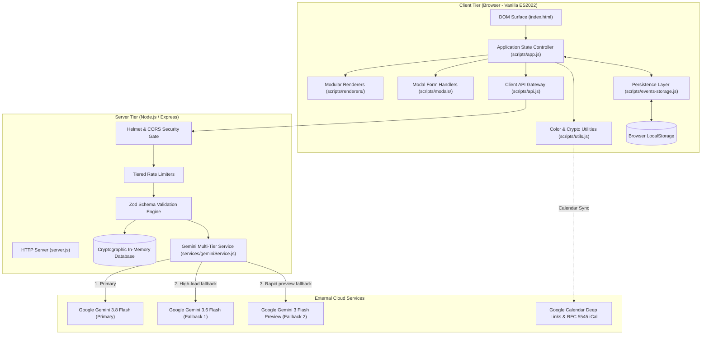

# AuraEvent — Architecture & System Specification

## 1. Executive Summary & Product Vision

**AuraEvent** is an enterprise-grade celebration and event planning studio built on the **Atelier Chroniqueur** design language. It integrates dynamic budget allocation, chronological timeline tracking, vendor management, calendar synchronization, and Google Gemini generative AI into a unified, zero-build web platform.

### Target Personas & Use Cases

- **Milestone Celebrants (Weddings, Anniversaries, Milestone Birthdays):** Couples and families requiring meticulous budget control, run-of-show synchronization, and inspirational creative direction without spreadsheet fatigue.
- **Corporate & Community Planners:** Organizers managing multi-vendor logistics, milestone phases (Ideation, Logistics, Ceremony, Reception, Breakdown), and exportable volunteer schedules.
- **Day-of-Event Coordinators:** Field managers tracking live milestone execution, vendor contacts, and task checklists on tablets and mobile devices.

---

## 2. Platform Architecture & Data Flow

---

## 3. Core Subsystems

### 3.1 Client State & Data Management

- **Reactive Model:** Unidirectional data flow where state mutations trigger dedicated sub-renderers without full page reloads.
- **Persistence & Synchronization:** Multi-event workspace state is stored in `localStorage` with cryptographic owner tokens (`X-Event-Owner-Token`) ensuring secure remote synchronization via the backend REST API (`/api/events/:id`).
- **Data Normalization:** Legacy and partial event schemas are safely normalized with default arrays and proportional budget allocations on initial load.

### 3.2 Backend Security & Validation

- **Defense-in-Depth:**
  - Content Security Policy (CSP), anti-clickjacking, and HTTP header protection via **Helmet**.
  - Dynamic CORS enforcement authorizing production domains (`.onrender.com`), localhost development, and rejecting untrusted origins.
  - Strict input validation on all routes via **Zod** schemas, preventing SQL/NoSQL injection, prompt injection, and prototype pollution.
  - Tiered in-memory rate limiting for AI endpoints (10 req/15min) and CRUD endpoints (100 req/15min).
  - Cryptographic token authorization for event mutations.

### 3.3 Google Gemini Generative AI Pipeline

- **Multi-Tier Cascade:** Requests target `gemini-3.8-flash` first, fall back to `gemini-3.6-flash`, then `gemini-3-flash-preview`, and finally graceful degradation to curated domain-expert offline plans if network or API keys are unavailable.
- **Prompt Isolation:** User inputs are sanitized to strip delimiters and injection attacks. Prompts enforce strict JSON contracts with validation schemas.
- **Deduplication & Selective Merging:** Users can preview generated plans, select individual recommendations, and merge them into expenses, milestones, and vendors without overwriting existing data.

### 3.4 Calendar Integration & Data Portability

- **RFC 5545 iCalendar:** Client-side `.ics` generator produces valid calendar payloads for Apple Calendar, Outlook, and mobile platforms.
- **Google Calendar URL Builder:** Deep links open Google Calendar pre-populated with milestone details, dates, and reminders.
- **JSON Backup & Restore:** Complete celebrations can be exported to encrypted/signed JSON files and restored with rigorous schema validation.

---

## 4. API Specification

| Endpoint          | Method | Auth / Headers        | Purpose                                                              |
| :---------------- | :----- | :-------------------- | :------------------------------------------------------------------- |
| `/api/health`     | GET    | None                  | Liveness and health check endpoint for monitoring & Render.          |
| `/health`         | GET    | None                  | Root health check alias for deployment platforms.                    |
| `/api/events`     | GET    | None                  | Retrieves all public / demo celebration outlines.                    |
| `/api/events/:id` | GET    | None                  | Retrieves a single celebration by ID.                                |
| `/api/events/:id` | PUT    | `X-Event-Owner-Token` | Persists or updates celebration state with cryptographic validation. |
| `/api/ai/ideas`   | POST   | None                  | Generates personalized event recommendations via Gemini API.         |

---

## 5. Technology Stack Justification

| Layer          | Choice                             | Rationale                                                                                                         |
| :------------- | :--------------------------------- | :---------------------------------------------------------------------------------------------------------------- |
| Frontend Core  | Vanilla ES2022, HTML5, CSS3 Tokens | Zero compilation step, instantaneous load, zero client-side supply chain vulnerabilities, lightweight deployment. |
| Backend Server | Node.js (>=18), Express            | High-performance asynchronous I/O, native JSON handling, broad hosting support.                                   |
| Security       | Helmet, express-rate-limit, Zod    | Enterprise-grade HTTP security, DDoS/brute-force mitigation, and runtime schema enforcement.                      |
| AI Integration | Google Gemini API (REST)           | State-of-the-art generative speed, structured JSON output adherence, multi-model fallback cascade.                |
